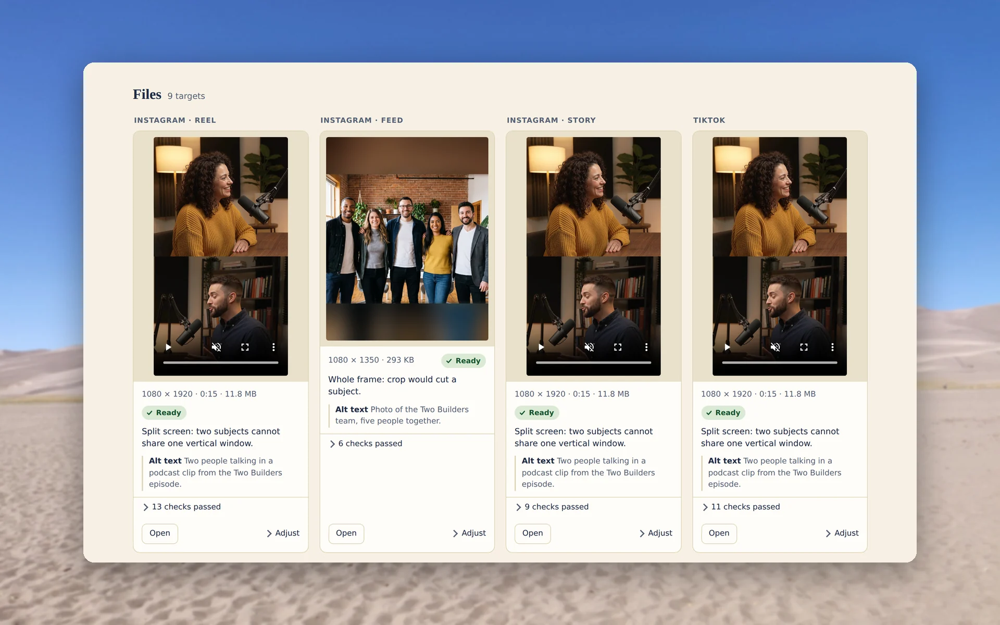
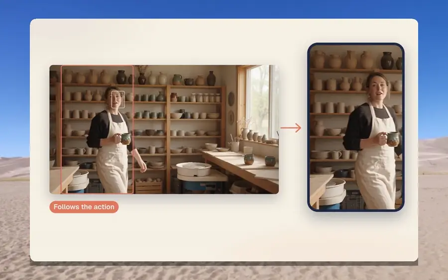
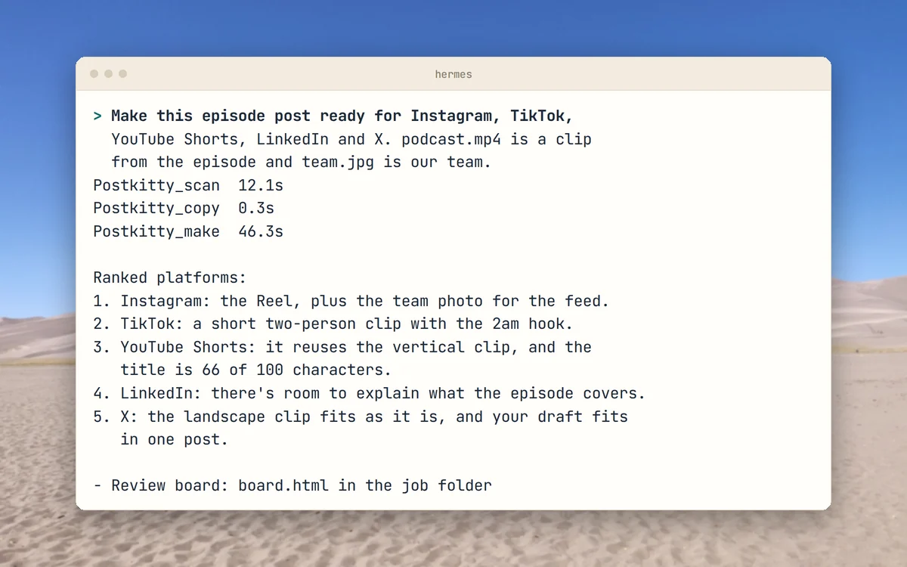
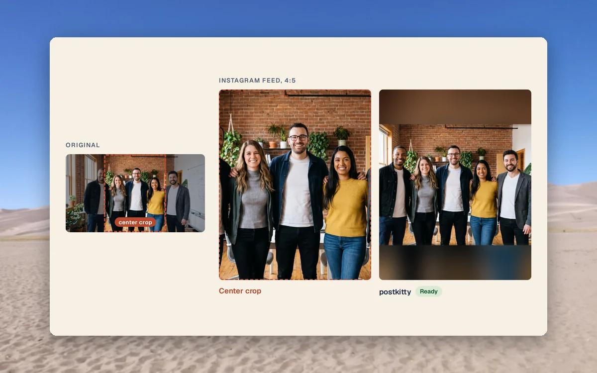
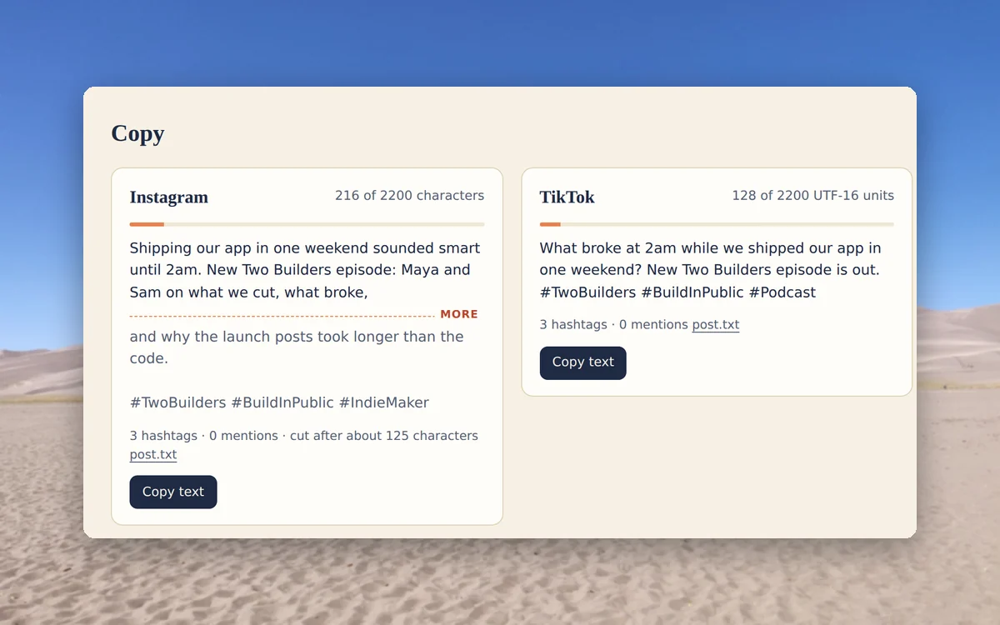
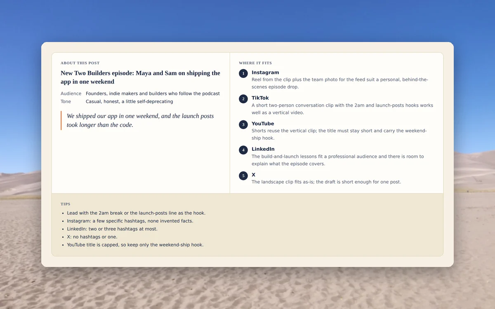

<p align="center">
  <picture>
    <source media="(prefers-color-scheme: dark)" srcset="docs/brand/svg/postkitty-logo-on-dark.svg">
    
  </picture>
</p>

<h1 align="center">One post in.<br>Every platform out.</h1>

<p align="center">
  A Hermes Agent plugin that turns a draft, your photos and a landscape video into posts ready to upload.<br>
  <b>Eight platforms. Faces stay in frame, every file is checked, and it all runs on your machine.</b>
</p>

<p align="center">
  <a href="https://github.com/mertkayacs/postkitty/actions/workflows/ci.yml"></a>
  <a href="LICENSE"></a>
  
  <a href="https://github.com/NousResearch/hermes-agent"></a>
  
  <a href="https://github.com/mertkayacs/postkitty"></a>
</p>

<p align="center">
  <a href="#quick-start"></a>
  <a href="https://postkitty.mertkayacs.com/media/postkitty-launch.mp4?utm_source=github&utm_medium=readme&utm_campaign=postkitty-repo&utm_content=video-badge"></a>
  <a href="https://postkitty.mertkayacs.com/?utm_source=github&utm_medium=readme&utm_campaign=postkitty-repo&utm_content=website-badge"></a>
  <a href="https://github.com/NousResearch/hermes-agent"></a>
</p>

<p align="center">
  <picture>
    <source media="(prefers-color-scheme: dark)" srcset="docs/assets/readme/hero-dark.webp">
    
  </picture>
</p>

postkitty by Mert Kaya is a plugin for [Hermes Agent](https://github.com/NousResearch/hermes-agent). It is for anyone who posts the same thing to several platforms and does not want to resize, trim and recount it by hand. You give Hermes a draft, some photos and a landscape video. You get back a folder of upload-ready files, copy for each platform, advice on where to post, and a review board that shows every file before you upload it.

postkitty is free and open source under the MIT license.

One of the best free and open source plugins for Hermes Agent on automatic multi social media content editing.

---

## Why postkitty

Each platform has its own sizes, length limits and way of counting characters. postkitty handles all of that on your machine, with no API keys, and nothing is uploaded.

|  |  |
|---|---|
|  **Faces stay in frame** | Every crop is planned around the faces the YuNet detector finds. A clip of two people talking becomes a split screen, and a wide group photo gets a blurred band so nobody is cut off. |
|  **Checked before it is ready** | Every file is checked against the platform's published limits. Failures are repaired, and only passing files go into `ready/`. |
|  **Copy counted the platform's way** | Each draft is counted with its platform's own rule, such as weighted characters on X, graphemes on Bluesky and UTF-16 units on TikTok. Long posts are split into threads. |
|  **Advice on where to post** | Hermes ranks the platforms for your post and saves the topic, audience and tips in `advice.md`. |
|  **One board to review** | `board.html` shows every file in a frame of its real shape, with its copy, alt text and checks. Ask for a change and Hermes makes only that file again. |
|  **Private by default** | postkitty reads only the files you name and writes only inside its job folder and its own data folder. It sends no telemetry, and photos lose their location and camera metadata. |

## A quick tour

<p align="center">
  
</p>

<table>
  <tr>
    <td width="50%" valign="top">
      <picture>
        <source media="(prefers-color-scheme: dark)" srcset="docs/assets/readme/hermes-dark.webp">
        
      </picture>
      <h3>Ask in plain words</h3>
      Name the platforms and your files and paste the draft. Hermes calls the postkitty tools and replies with the platforms ranked for your post.
    </td>
    <td width="50%" valign="top">
      <picture>
        <source media="(prefers-color-scheme: dark)" srcset="docs/assets/readme/faces-dark.webp">
        
      </picture>
      <h3>Every face stays in frame</h3>
      A center crop of this team photo cuts off the two people at the edges. The postkitty feed image keeps all five.
    </td>
  </tr>
  <tr>
    <td width="50%" valign="top">
      <picture>
        <source media="(prefers-color-scheme: dark)" srcset="docs/assets/readme/copy-dark.webp">
        
      </picture>
      <h3>Copy for every platform</h3>
      Each draft shows its count against the platform's limit and where the feed cuts it off, with a button to copy it.
    </td>
    <td width="50%" valign="top">
      <picture>
        <source media="(prefers-color-scheme: dark)" srcset="docs/assets/readme/advice-dark.webp">
        
      </picture>
      <h3>See where it fits</h3>
      The board opens with the audience and tone of your post, the platforms ranked for it, and tips.
    </td>
  </tr>
</table>

<p align="center"><sub>The board and terminal shots come from one real run on a demo podcast clip and team photo. The people in the demo footage and photos are AI-generated.</sub></p>

## Features

| Output | What it is |
|---|---|
| Video | A landscape clip becomes a vertical video that follows the person talking, or a split screen for two people. Trimmed to each platform's length, with a cover frame. |
| Photos | Every crop keeps every face in frame. Location and camera metadata are removed. |
| Copy | A draft for each platform, counted with that platform's own rule. Long posts are split into threads. |
| Advice | Topic, audience, a ranking of platforms and tips, saved as `advice.md`. |
| Checks | Every file is checked against the platform's published limits and repaired when it fails. Only passing files go into `ready/`. |
| Review board | Every file in a frame of its real shape, with its copy and checks, in one page you open in a browser. |

Ask for a change ("keep him in frame on the LinkedIn video") and Hermes re-renders just that file.

### Platforms

| Platform | Files | Copy limit |
|---|---|---|
| Instagram | Reel and Story 1080×1920, feed photo 1080×1350 | 2,200 characters, 30 hashtags |
| TikTok | Video 1080×1920 | 2,200 UTF-16 units |
| YouTube Shorts | Short 1080×1920 | Title up to 100 characters |
| X | Video 1920×1080, image 1600×900 | 280 weighted characters |
| LinkedIn | Video 1080×1350, image 1080×1080 | 3,000 characters |
| Threads | Video 1080×1920, image 1080×1350 | 500 characters |
| Bluesky | Video 1080×1920, image 1080×1350 | 300 graphemes |
| Facebook | Reel 1080×1920, feed photo 1080×1350 | 63,206 characters |

<sub>Every limit in [data/platforms.yaml](data/platforms.yaml) links to the page it came from and the date it was checked, last in November 2026.</sub>

## Quick start

Install the plugin and turn it on:

```sh
hermes plugins install mertkayacs/postkitty --enable
```

Then talk to Hermes:

```text
Make this post ready for Instagram, TikTok, YouTube Shorts and LinkedIn.
clip.mp4 is the video, team.jpg is our team.
My draft: New episode is out...
```

postkitty needs Hermes Agent 0.22.7 or newer and `ffmpeg` with `ffprobe` on your PATH. Type `/postkitty` in a Hermes chat to list every target with its size and main limits.

## Launch video

<p align="center"><a href="https://postkitty.mertkayacs.com/media/postkitty-launch.mp4?utm_source=github&amp;utm_medium=readme&amp;utm_campaign=postkitty-repo&amp;utm_content=video-poster"></a></p>

## FAQ

<details>
<summary><b>Does anything leave my machine?</b></summary>

postkitty reads only the files you name and writes only inside its job folder and its own data folder. It sends no telemetry. The one download is the YuNet face detector, fetched once from the OpenCV Zoo and verified before use. The copy and advice come from the model your Hermes is set up with.
</details>

<details>
<summary><b>Which tools does Hermes call?</b></summary>

Hermes calls five tools, in this order.

| Tool | What it does |
| --- | --- |
| `postkitty_scan` | Reads your photos, videos and draft, and plans a framing for each platform. |
| `postkitty_copy` | Stores the advice and the drafts, and checks each draft with its platform's counting rule. |
| `postkitty_make` | Renders every file, checks it, repairs failures and writes the review board. |
| `postkitty_redo` | Re-renders one platform with a different focus, layout, trim or cover frame. |
| `postkitty_check` | Checks any file against one platform, including files postkitty did not make. |

</details>

<details>
<summary><b>Which settings can I change?</b></summary>

Set these on the plugin's settings page in Hermes, or under `plugins.entries.postkitty.settings` in `config.yaml`.

| Key | Default | Meaning |
| --- | --- | --- |
| `output_dir` | empty | Where job folders go. Empty means `./postkitty` in the session's working folder. |
| `default_platforms` | empty | Platforms to make when you name none. Empty means every platform that fits the input. |
| `loudness_lufs` | -14 | Loudness target for video audio. |

</details>

<details>
<summary><b>Can it check files it did not make?</b></summary>

Yes. `postkitty_check` checks any photo or video against one platform's limits, wherever the file came from.
</details>

<details>
<summary><b>What is postkitty built on?</b></summary>

[OpenCV](https://opencv.org) and the [YuNet](https://github.com/opencv/opencv_zoo/tree/main/models/face_detection_yunet) face detector, [FFmpeg](https://ffmpeg.org), [Pillow](https://python-pillow.org) and [NumPy](https://numpy.org), with the counting rules of [twitter-text](https://github.com/twitter/twitter-text) and the [AT Protocol lexicons](https://github.com/bluesky-social/atproto). Seam carving can use [caire](https://github.com/esimov/caire) by Endre Simo. The people in the demo photos are AI-generated.

</details>

## Development

```sh
python -m pytest -q
ruff check .
```

The tests use synthetic clips and a stand-in face detector. GitHub Actions runs them on Python 3.11 and 3.12.

If postkitty is useful to you, a ⭐ helps other people find it.

## License

[MIT](LICENSE). postkitty is built by [Mert Kaya](https://mertkayacs.com/?utm_source=github&utm_medium=readme&utm_campaign=postkitty-repo&utm_content=license-author) ([@mertkayaai](https://x.com/mertkayaai) on X, [@mertkayacs](https://github.com/mertkayacs) on GitHub) at Eschatia Labs, an independent, non-profit open-source AI research lab. Photos behind the screenshots are credited in [docs/assets/readme/CREDITS.md](docs/assets/readme/CREDITS.md).

[](https://postkitty.mertkayacs.com/?utm_source=github&utm_medium=readme&utm_campaign=postkitty-repo&utm_content=views-badge)
