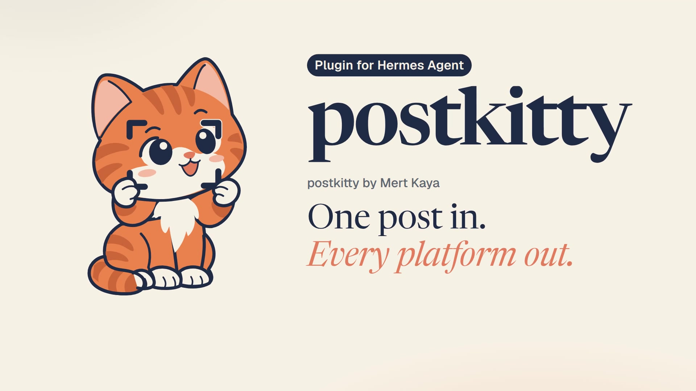
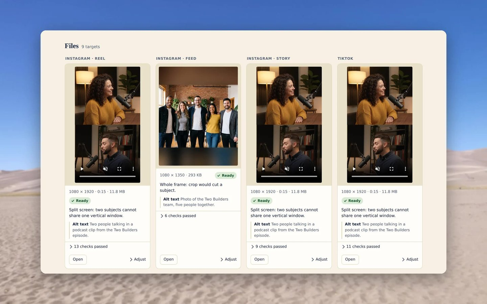

<p align="center">
  <picture>
    <source media="(prefers-color-scheme: dark)" srcset="docs/brand/svg/postkitty-logo-on-dark.svg">
    
  </picture>
</p>

<h1 align="center">One post in.<br>Every platform out.</h1>

<p align="center">
  A Hermes Agent plugin for your text, photos and video. It fixes and rewrites your draft for each platform, keeps every face in frame, and checks every file before you post.<br>
  <b>Eight platforms, every file checked, all on your machine.</b>
</p>

<p align="center">
  <a href="https://github.com/mertkayacs/postkitty/actions/workflows/ci.yml"></a>
  <a href="LICENSE"></a>
  
  <a href="https://github.com/NousResearch/hermes-agent"></a>
  
  <a href="https://github.com/mertkayacs/postkitty"></a>
</p>

<p align="center">
  <a href="#install"></a>
  <a href="https://postkitty.mertkayacs.com/media/postkitty-launch.mp4?utm_source=github&utm_medium=readme&utm_campaign=postkitty-repo&utm_content=video-badge"></a>
  <a href="https://postkitty.mertkayacs.com/try/?utm_source=github&utm_medium=readme&utm_campaign=postkitty-repo&utm_content=try-badge"></a>
  <a href="https://postkitty.mertkayacs.com/docs/?utm_source=github&utm_medium=readme&utm_campaign=postkitty-repo&utm_content=docs-badge"></a>
  <a href="https://postkitty.mertkayacs.com/?utm_source=github&utm_medium=readme&utm_campaign=postkitty-repo&utm_content=website-badge"></a>
  <a href="https://github.com/NousResearch/hermes-agent"></a>
</p>

postkitty by Mert Kaya is a plugin for [Hermes Agent](https://github.com/NousResearch/hermes-agent) that turns one post (a draft, photos, a landscape video, or only text) into a folder of upload-ready files for Instagram, TikTok, YouTube Shorts, X, LinkedIn, Threads, Bluesky and Facebook, each one checked against that platform's published limits and repaired when it fails.

One of the best free and open source plugins for Hermes Agent on automatic multi social media content editing.

<p align="center"><a href="https://postkitty.mertkayacs.com/media/postkitty-launch.mp4?utm_source=github&amp;utm_medium=readme&amp;utm_campaign=postkitty-repo&amp;utm_content=video-poster"></a></p>

---

## What the plugin does on your machine

-  **Finds the faces in a photo and tracks them through a video.** Crops and vertical clips are built around those people, so they stay in frame.
-  **Renders with ffmpeg.** You get upload files at each platform's size, trimmed to its length, and every video comes with a cover frame.
-  **Counts text the way each platform does:** weighted characters on X, graphemes on Bluesky, UTF-16 units on TikTok.
-  **Checks every file against the platform's published limits and repairs what fails.** Only passing files reach `ready/`.
-  **Builds a review board,** one page that shows every file with its text, alt text and checks.
-  **Answers `/postkitty` without the model:** every size and limit, plus a check of your setup.

The words come from the model your Hermes uses: the rewritten drafts, the advice on where to post, and the alt text. The rest is code in this repository.

<p align="center"></p>

## Install

```sh
hermes plugins install postkitty
```

Answer yes when Hermes asks to install the Python packages and to turn the plugin on. Then open a new chat, because Hermes loads a plugin's tools when a chat starts.

## What you need

- **Hermes Agent 0.22.7 or newer**, running on Python 3.11 or newer.
- **Four Python packages:** OpenCV, NumPy, Pillow and regex. Hermes installs them during the install step.
- **ffmpeg with ffprobe on your PATH, for video only.** Text and photos work without it. Burning in captions needs an ffmpeg build with libass.

To check all of it, type this in a Hermes chat. It prints one fix line for each thing that is missing.

```text
/postkitty doctor
```

## Say this to your Hermes

Hermes can do the install for you. Send these two messages, the second one in a new chat.

```text
Install the postkitty plugin for me: run `hermes plugins install postkitty --yes-deps --enable` in the terminal. When it finishes, tell me to open a new chat so its tools load.
```

```text
Use postkitty to turn this into posts for X, LinkedIn and Instagram and fix my wording: [your draft, or the path to a photo or video]
```

## What it can do

| Say this | You get |
|---|---|
| **Text**<br>"Fix my wording and write this for X, LinkedIn and Threads: [your draft]" | Your draft with the spelling and grammar fixed, one version per platform, each counted to fit. A long post can become a thread. |
| **Photos**<br>"Make team.jpg ready for Instagram and Bluesky, and keep everyone in the picture." | One image per feed, framed around the people in it, with location and camera metadata removed. |
| **Video**<br>"Turn talk.mp4 into vertical clips for TikTok, Reels and Shorts." | Vertical clips that follow the person on screen. Two people get a split screen, a cut to whoever is talking, or the whole wide shot. |
| **Captions**<br>"Burn the subtitles from talk.srt into the TikTok clip." | Your `.srt` or `.vtt` subtitles drawn into the video, clear of the platform's buttons. |
| **Checks**<br>"Will this file upload to TikTok? [path to the file]" | A pass or a fail against TikTok's limits, with every failing check named. It works for files postkitty did not make. |

postkitty never posts, uploads or schedules anything. You upload the files in `ready/` yourself.

<p align="center"></p>

<p align="center"><sub>The review board of one real run on a demo podcast clip and team photo. The people in the demo footage and photos are AI-generated.</sub></p>

## How to ask

- Name the platforms: "for Instagram and TikTok" tells postkitty which files to make.
- Give the path of each photo or video and paste your draft.
- Say who has to stay in frame: "keep everyone in the picture" or "focus on the person on the left".
- With two people on camera, name the layout: a split screen, a cut to whoever is talking, or the whole wide shot.
- Give times for a trim and a cover frame: "use 0:12 to 0:48 and take the cover at 0:20".
- Ask for a change in plain words afterwards: "shorter for X" or "more formal on LinkedIn". Hermes redoes only that part.

[docs/how-to-ask.md](docs/how-to-ask.md) is the full guide, with a vague request next to a clear one for each case.

## Platforms

| Platform | Files | Text limit |
|---|---|---|
| Instagram | Reel and Story 1080×1920, feed photo 1080×1350 | 2,200 characters, 5 hashtags |
| TikTok | Video 1080×1920 | 2,200 UTF-16 units |
| YouTube Shorts | Short 1080×1920 | Title up to 100 characters |
| X | Video 1920×1080, image 1600×900 | 280 weighted characters |
| LinkedIn | Video 1080×1350, image 1080×1080 | 3,000 characters |
| Threads | Video 1080×1920, image 1080×1350 | 500 characters |
| Bluesky | Video 1080×1920, image 1080×1350 | 300 graphemes |
| Facebook | Reel 1080×1920, feed photo 1080×1350 | 63,206 characters |

<sub>[docs/platforms.md](docs/platforms.md) lists every limit with the page it came from and the date it was checked. The data lives in [data/platforms.yaml](data/platforms.yaml).</sub>

## Try it in the browser

Paste a draft or drop a photo or a video at [postkitty.mertkayacs.com/try](https://postkitty.mertkayacs.com/try/?utm_source=github&utm_medium=readme&utm_campaign=postkitty-repo&utm_content=try-link) and get the result for each platform, with nothing to install.

The same engine answers over HTTP at `https://postkitty.mertkayacs.com/api`. [docs/api.md](docs/api.md) has the endpoints, and the [docs site](https://postkitty.mertkayacs.com/docs/?utm_source=github&utm_medium=readme&utm_campaign=postkitty-repo&utm_content=docs-link) carries every guide in English, Turkish and German.

## Documentation

| Guide | What is in it |
|---|---|
| [How to ask](docs/how-to-ask.md) | Requests that get the right result the first time |
| [Tools](docs/tools.md) | The five tools, the `/postkitty` command and the settings |
| [Layouts](docs/layouts.md) | crop, split, speaker, seam, pad and focus, with examples |
| [Platforms](docs/platforms.md) | Every size and limit with its source |
| [HTTP API](docs/api.md) | The hosted API behind the playground |
| [Architecture](docs/architecture.md) | How the code is organised and how a job runs |
| [Troubleshooting](docs/troubleshooting.md) | What each failure message means and what to do |

## FAQ

<details>
<summary><b>What it touches on your machine</b></summary>

- **Network:** one download. The first time a photo or a video is scanned, postkitty fetches the YuNet face detector from the OpenCV Zoo repository on GitHub, pinned to one commit, and checks its size and SHA-256 before using it. It makes no other request and sends no telemetry.
- **Files it reads:** the photos, videos and subtitle files you name. It leaves them unchanged.
- **Files it writes:** the job folder (`./postkitty` in the session's working folder unless you set another one) and its own data folder in the Hermes home, `plugin-data/postkitty/`, which holds the face model and cached detections.
- **Commands it runs:** `ffmpeg` and `ffprobe`, only while a tool call is working. The seam layout uses `caire` when it is installed.
- **Background processes:** none.
- **Credentials:** none. It needs no API key and stores no account data.
- **The model:** your draft goes to the model your Hermes is set up with, as in any Hermes chat. That model writes the text, the advice and the alt text.

[SECURITY.md](SECURITY.md) says how to report a problem.

</details>

<details>
<summary><b>Where are my files?</b></summary>

Each job gets its own folder. The files to upload are under `ready/`, one folder per platform.

```text
postkitty/20261111-0930-talk/
  ready/
    instagram/   reel.mp4  reel_cover.jpg  feed.jpg  post.txt  alt.txt
    tiktok/      tiktok.mp4  tiktok_cover.jpg  post.txt
    x/           video.mp4  video_cover.jpg  thread.txt
  board.html     the review board
  advice.md      the platforms ranked for this post, with tips
  contact.png    every file on one image
  manifest.json  what was made, with every check
  work/          caches and intermediate renders
```

</details>

<details>
<summary><b>Which tools does Hermes call?</b></summary>

Five tools, in this order. [docs/tools.md](docs/tools.md) has the arguments and the results.

| Tool | What it does |
| --- | --- |
| `postkitty_scan` | Reads your photos, videos and draft, and plans a framing for each platform. Renders nothing. |
| `postkitty_write` | Counts each platform's text with its real rule and writes the text files. |
| `postkitty_make` | Renders every file, checks it, repairs failures and builds the review board. |
| `postkitty_redo` | Makes one photo or video output again with another layout, focus, trim, cover frame or captions. |
| `postkitty_check` | Checks a file postkitty did not make against one platform. |

</details>

<details>
<summary><b>Which settings can I change?</b></summary>

Set these on the plugin's settings page in Hermes, or under `plugins.entries.postkitty.settings` in `config.yaml`.

| Key | Default | Meaning |
| --- | --- | --- |
| `output_dir` | empty | Where job folders go. Empty means `./postkitty` in the session's working folder. |
| `default_platforms` | empty | Platforms to make when you name none. Empty means every platform that fits the input. |
| `loudness_lufs` | -14 | Loudness target for video audio. |

</details>

<details>
<summary><b>A real run: one draft, rewritten for X, Bluesky and LinkedIn</b></summary>

**The draft**

> new episode of two builders is out!! maya and sam talks about how we shiped our app in one weekend, what we cut what broke at 2am and why the launch posts took longer then the code lol. its honestly the most usefull episode we did so far for anyone building on there own

**X** · 245 of 280 weighted characters

> New episode of Two Builders is out. Maya and Sam talk about how we shipped our app in one weekend: what we cut, what broke at 2am, and why the launch posts took longer than the code. Our most useful episode so far if you're building on your own.

**Bluesky** · 221 of 300 graphemes

> New Two Builders episode is out. Maya and Sam on shipping our app in one weekend: what we cut, what broke at 2am, and why the launch posts took longer than the code. Our most useful one yet if you're building on your own.

**LinkedIn** · 319 of 3,000 characters

> New episode of Two Builders is out.
>
> Maya and Sam talk about how we shipped our app in one weekend: what we cut, what broke at 2am, and why the launch posts took longer than the code.
>
> It's honestly the most useful episode we've done so far, especially if you're building on your own.
>
> #BuildInPublic #Startups #Podcast

The next message in the same chat asked for a change:

> Make the LinkedIn post more formal, and turn the X post into a thread of two posts.

**X thread, post 1** · 98 of 280 weighted characters

> New episode of Two Builders is out. Maya and Sam talk about how we shipped our app in one weekend.

**X thread, post 2** · 146 of 280 weighted characters

> What we cut, what broke at 2am, and why the launch posts took longer than the code. Our most useful episode so far if you're building on your own.

**LinkedIn, more formal** · 337 of 3,000 characters

> We have released a new episode of Two Builders.
>
> Maya and Sam discuss how we shipped our app in one weekend: what we cut, what broke at 2am, and why the launch posts took longer to produce than the code.
>
> It is the most useful episode we have made so far, particularly for anyone building on their own.
>
> #BuildInPublic #Startups #Podcast

<details>
<summary><b>It works in your language: the same post in Turkish and German</b></summary>

**Turkish draft**

> two builders'ın yeni bölümü çıktı!! maya ve sam uygulamamızı bir hafta sonunda nasıl yayınladığımızı anlatıyo, neleri kestik gece 2de ne bozuldu ve lansman paylaşımları neden koddan uzun sürdü. kendi başına bir şey geliştiren herkez için şimdiye kadarki en faydalı bölüm bence

**X** · 270 of 280 weighted characters

> Two Builders'ın yeni bölümü çıktı! Maya ve Sam, uygulamamızı bir hafta sonunda nasıl yayınladığımızı anlatıyor: neleri kestik, gece 2'de ne bozuldu, lansman paylaşımları neden koddan uzun sürdü. Kendi başına geliştiren herkes için şimdiye kadarki en faydalı bölüm bence.

**German draft**

> neue folge von two builders ist drausen!! maya und sam erzählen wie wir unsere app an einem wochenende gelauncht haben, was wir gestrichen haben was um 2 uhr nachts kaputt ging und warum die launch posts länger gedauert haben als der code. ehrlich die nützlichste folge bis jetzt für alle die alleine was bauen

**X** · 235 of 280 weighted characters

> Neue Folge von Two Builders ist da. Maya und Sam erzählen, wie wir unsere App an einem Wochenende gelauncht haben: was wir gestrichen haben, was um 2 Uhr nachts kaputt ging und warum die Launch-Posts länger gedauert haben als der Code.

</details>

<sub>The text comes from the model your Hermes uses. These runs used Claude Sonnet 5.5, and postkitty counted and checked every version.</sub>

</details>

<details>
<summary><b>How do I update or remove it?</b></summary>

```sh
hermes plugins update postkitty
hermes plugins remove postkitty
```

Your job folders stay where they are when you remove the plugin.

</details>

<details>
<summary><b>What is postkitty built on?</b></summary>

[OpenCV](https://opencv.org) and the [YuNet](https://github.com/opencv/opencv_zoo/tree/main/models/face_detection_yunet) face detector, [FFmpeg](https://ffmpeg.org), [Pillow](https://python-pillow.org) and [NumPy](https://numpy.org), with the counting rules of [twitter-text](https://github.com/twitter/twitter-text) and the [AT Protocol lexicons](https://github.com/bluesky-social/atproto). Seam carving can use [caire](https://github.com/esimov/caire) by Endre Simo.

</details>

## Development

```sh
python -m pytest -q
ruff check .
```

The tests use synthetic clips and a stand-in face detector, so they download nothing.

- `plugin.yaml`, `__init__.py`: the manifest and `register(ctx)`
- `schemas.py`, `tools.py`: what Hermes sees, and the handlers behind it
- `command.py`: the `/postkitty` command
- `engine/`: the library, with `pipeline`, `photo`, `video`, `text`, `verify` and `board`
- `data/platforms.yaml`: every size and limit, with its source
- `skills/postkitty/SKILL.md`: the workflow Hermes follows

[docs/architecture.md](docs/architecture.md) explains the layers and the life of a job. [CONTRIBUTING.md](CONTRIBUTING.md) covers setup, style and how to add a platform, and [CHANGELOG.md](CHANGELOG.md) lists what changed in each release.

If postkitty is useful to you, a star helps other people find it.

## License

[MIT](LICENSE). postkitty is built by [Mert Kaya](https://mertkayacs.com/?utm_source=github&utm_medium=readme&utm_campaign=postkitty-repo&utm_content=license-author) ([@mertkayaai](https://x.com/mertkayaai) on X, [@mertkayacs](https://github.com/mertkayacs) on GitHub) at Eschatia Labs, an independent, non-profit open-source AI research lab. Photos behind the screenshots are credited in [docs/assets/readme/CREDITS.md](docs/assets/readme/CREDITS.md).

[](https://postkitty.mertkayacs.com/?utm_source=github&utm_medium=readme&utm_campaign=postkitty-repo&utm_content=views-badge)
