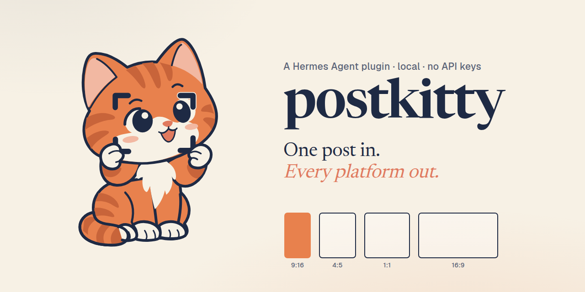
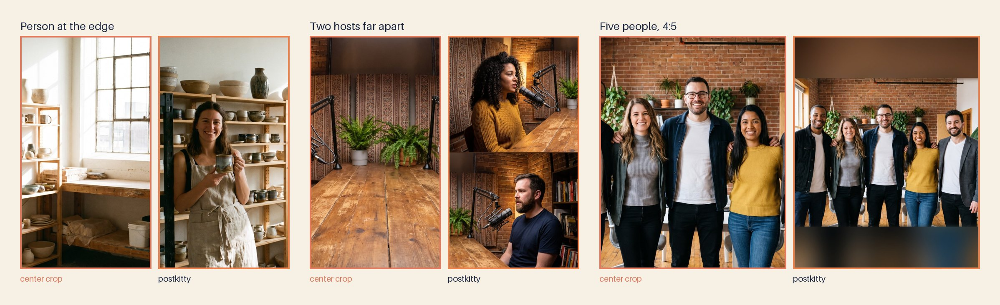
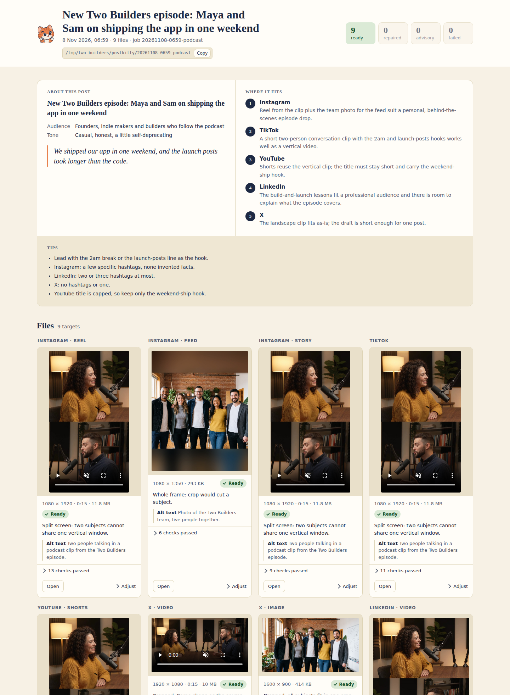

<p align="center"><a href="https://postkitty.mertkayacs.com"></a></p>

<p align="center">
  <a href="https://github.com/mertkayacs/postkitty/actions/workflows/ci.yml"></a>
  <a href="LICENSE"></a>
  
  <a href="https://github.com/NousResearch/hermes-agent"></a>
  <a href="LICENSE"></a>
</p>

postkitty is free and open source under the MIT license.

One of the best free and open source plugins for Hermes Agent on automatic multi social media content editing.

<p align="center">
  <a href="https://postkitty.mertkayacs.com"><b>Site</b></a> ·
  <a href="https://postkitty.mertkayacs.com"><b>Launch video</b></a> ·
  <a href="#install"><b>Install</b></a> ·
  <a href="https://github.com/mertkayacs/postkitty/issues"><b>Issues</b></a>
</p>

<p align="center"><b>One post in, every platform out.</b></p>

postkitty by Mert Kaya is a plugin for [Hermes Agent](https://github.com/NousResearch/hermes-agent). It is for anyone
who posts the same thing to several platforms and does not want to resize, trim and recount it by hand. You give Hermes a
draft, some photos and a landscape video. You get back a folder of upload-ready files, copy for each platform, advice on
where to post, and a review board that shows every file before you upload it.

Everything runs on your machine. There are no API keys and nothing is uploaded.



## Quick Start

```sh
hermes plugins install mertkayacs/postkitty --enable
```

Then talk to Hermes:

> Make this post ready for Instagram, TikTok, YouTube Shorts and LinkedIn. clip.mp4 is the video, team.jpg is our team.
> My draft: New episode is out...

## What It Gives You

| Surface | Use it for |
| --- | --- |
| **Video** | A landscape clip becomes a vertical video that follows the person talking, or a split screen for two people. Trimmed to each platform's length, with a cover frame. |
| **Photos** | Every crop keeps every face in frame. Location and camera metadata are removed. |
| **Copy** | A draft for each platform, counted with that platform's own rule. Long posts are split into threads. |
| **Advice** | Topic, audience, a ranking of platforms and tips, saved as `advice.md`. |
| **Checks** | Every file is checked against the platform's published limits and repaired when it fails. Only passing files go into `ready/`. |
| **Review board** | Every file in a frame of its real shape, with its copy and checks, in one page you open in a browser. |

Ask for a change ("keep him in frame on the LinkedIn video") and Hermes re-renders just that file.



## Platforms

Instagram · TikTok · YouTube Shorts · X · LinkedIn · Threads · Bluesky · Facebook

<a id="install"></a>
<details>
<summary><strong>Install</strong></summary>

postkitty needs Hermes Agent 0.22.7 or newer and `ffmpeg` with `ffprobe` on your PATH.

```sh
hermes plugins install mertkayacs/postkitty --enable
```

</details>

<a id="tools"></a>
<details>
<summary><strong>Tools</strong></summary>

Hermes calls five tools, in this order.

| Tool | What it does |
| --- | --- |
| `postkitty_scan` | Reads your photos, videos and draft, and plans a framing for each platform. |
| `postkitty_copy` | Stores the advice and the drafts, and checks each draft with its platform's counting rule. |
| `postkitty_make` | Renders every file, checks it, repairs failures and writes the review board. |
| `postkitty_redo` | Re-renders one platform with a different focus, layout, trim or cover frame. |
| `postkitty_check` | Checks any file against one platform, including files postkitty did not make. |

Type `/postkitty` in a Hermes chat to list every target with its size and main limits.

</details>

<a id="settings"></a>
<details>
<summary><strong>Settings</strong></summary>

Set these on the plugin's settings page in Hermes, or under `plugins.entries.postkitty.settings` in `config.yaml`.

| Key | Default | Meaning |
| --- | --- | --- |
| `output_dir` | empty | Where job folders go. Empty means `./postkitty` in the session's working folder. |
| `default_platforms` | empty | Platforms to make when you name none. Empty means every platform that fits the input. |
| `loudness_lufs` | -14 | Loudness target for video audio. |

</details>

<a id="privacy"></a>
<details>
<summary><strong>Privacy</strong></summary>

postkitty reads only the files you name and writes only inside its job folder and its own data folder. It sends no
telemetry. The one download is the YuNet face detector, fetched once from the OpenCV Zoo and verified before use. The
copy and advice come from the model your Hermes is set up with.

</details>

<a id="development"></a>
<details>
<summary><strong>Development</strong></summary>

```sh
python -m pytest -q
ruff check .
```

The tests use synthetic clips and a stand-in face detector. GitHub Actions runs them on Python 3.11 and 3.12.

</details>

<a id="credits"></a>
<details>
<summary><strong>Credits</strong></summary>

Pucci the kitten is the mascot. postkitty is built on [OpenCV](https://opencv.org) and the
[YuNet](https://github.com/opencv/opencv_zoo/tree/main/models/face_detection_yunet) face detector,
[FFmpeg](https://ffmpeg.org), [Pillow](https://python-pillow.org) and [NumPy](https://numpy.org), with the counting
rules of [twitter-text](https://github.com/twitter/twitter-text) and the
[AT Protocol lexicons](https://github.com/bluesky-social/atproto). Seam carving can use
[caire](https://github.com/esimov/caire) by Endre Simo. The people in the demo photos are AI-generated.

</details>

## Links

- Website: https://postkitty.mertkayacs.com
- GitHub: https://github.com/mertkayacs/postkitty
- Hermes Agent: https://github.com/NousResearch/hermes-agent
- Mert Kaya: https://mertkayacs.com
- Mert Kaya on X: [@mertkayaai](https://x.com/mertkayaai)
- Mert Kaya on GitHub: [@mertkayacs](https://github.com/mertkayacs)
- License: [MIT](LICENSE)


<a href="https://eschatialabs.com"><picture><source media="(prefers-color-scheme: dark) and (min-resolution: 2dppx)" srcset="https://eschatialabs.com/brand/lockup-46-dark@2x.png"><source media="(prefers-color-scheme: dark)" srcset="https://eschatialabs.com/brand/lockup-46-dark@1x.png"><source media="(min-resolution: 2dppx)" srcset="https://eschatialabs.com/brand/lockup-46@2x.png"></picture></a><br>An [Eschatia Labs](https://eschatialabs.com) project by [Mert Kaya](https://mertkayacs.com).
