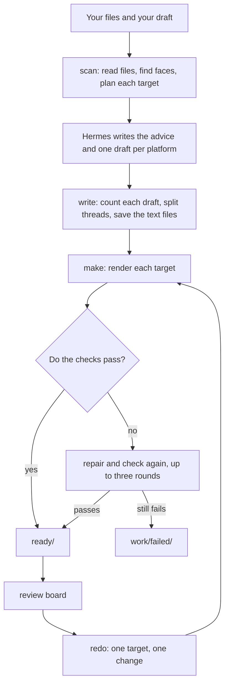

# Architecture

postkitty has three layers: a thin Hermes adapter, an engine that is a plain Python library, and one data file. The adapter is the only part that knows Hermes. The hosted HTTP API calls the same engine.

- [Layers](#layers)
- [The life of a job](#the-life-of-a-job)
- [The job folder](#the-job-folder)
- [Checks and repairs](#checks-and-repairs)
- [Platform data, and how to add a platform](#platform-data-and-how-to-add-a-platform)
- [The face model](#the-face-model)
- [What stays on the machine](#what-stays-on-the-machine)

## Layers

```text
plugin.yaml            manifest: name, version, tools, dependencies, settings
__init__.py            register(ctx): the five tools, the skill, the /postkitty command
schemas.py             tool names, descriptions and JSON parameters (what the model reads)
tools.py               handlers: read arguments, call engine.pipeline, return JSON
command.py             the text of the /postkitty command
engine/
  pipeline.py          scan, write, make, redo, check as plain functions, plus configure()
  platforms.py         loads data/platforms.yaml into typed specs
  job.py               job folder and manifest
  probe.py             what a file is (ffprobe, Pillow, SHA-256)
  doctor.py            the setup check
  advise.py            fit facts per platform
  detect/              faces.py (detector, cache), models.py (model download)
  photo/               framing.py, seams.py, render.py, checks.py
  video/               scan.py, camera.py, speakers.py, render.py, captions.py, checks.py
  text/                fit.py (counting, thread splitting)
  verify/              checks.py, repair.py (the shared check and repair core)
  board/               board.py and its templates
data/platforms.yaml    every size and limit, with its source
skills/postkitty/      SKILL.md, the workflow Hermes follows
tests/
```

**The Hermes adapter** is `__init__.py`, `schemas.py`, `tools.py` and `command.py`. `register(ctx)` registers the tools in the `postkitty` toolset, the skill and the command. A handler takes `(args, **kwargs)`, returns a JSON string and never raises: an exception from the engine becomes `{"error": "...", "hint": "..."}`. The handlers also read the plugin settings from Hermes and pass them to the engine.

**The engine** imports nothing from Hermes. The adapter hands it the session's working folder and the plugin's data folder. Without them it uses the current directory and `~/.cache/postkitty`. OpenCV, NumPy and Pillow are imported by the call that needs them, so loading the plugin stays cheap and a missing package switches off one kind of media while text keeps working.

`engine.pipeline` is the public Python API. Each step takes one dict and returns one dict, with the same keys the tools use ([Tools](tools.md)). Errors are raised.

```python
from engine import pipeline

pipeline.configure(output_dir="/data/jobs")
job = pipeline.scan({"inputs": ["/data/in/team.jpg"], "text": "We shipped.", "platforms": ["instagram", "x"]})
pipeline.write({"job": job["job"], "drafts": {"x": "We shipped."}})
made = pipeline.make({"job": job["job"]})
```

**The data** is `data/platforms.yaml`. No size or limit lives in code.

## The life of a job



1. **scan** reads each file with ffprobe or Pillow and hashes it. A job is made from one photo, one video, or one of each. It runs the face detector on a photo, or on frames sampled from a video, where it also finds the shots, the audio level over time and one track per person. From that it plans a layout for every target, and for video a trim and a cover frame. The plan is saved, and nothing is rendered.
2. **Hermes** looks at the preview image and the facts scan returned, then writes the advice, a draft per platform and the alt text. This is the only step done by the model.
3. **write** counts each draft in its platform's unit, checks the hashtag, mention and byte caps, splits a thread where that is allowed, and saves the text files.
4. **make** renders each target: Pillow for photos, ffmpeg for video (H.264 and AAC in an MP4, audio set to the loudness target, HDR tone-mapped to SDR, surround sound mixed down to stereo). Every file then goes through its checks. A failing hard check starts a repair, and the file is checked again. A passing file is copied to `ready/`, and a video gets its cover frame. Then the board is built.
5. **redo** renders one target again with the keys that changed. The scan and the detections are reused.

Detections are stored by the SHA-256 of the file, so an unchanged file is detected once, across jobs too. A file that changed after the scan is refused with a message to scan again.

## The job folder

Each job gets a folder named from the date, the time and the first file, for example `20261111-0930-talk`. It sits in `./postkitty` in the session's working folder, or in the `output_dir` setting.

```text
20261111-0930-talk/
  manifest.json          inputs, text, advice and every target with its checks
  advice.md              topic, audience, tone, platform ranking, tips
  board.html             the review board; it links to the files in ready/
  board-inline.html      the same board as one self-contained file
  contact.png            every file on one image
  ready/
    <platform>/          <name>.mp4 | .jpg | .png, <name>_cover.jpg, post.txt | thread.txt, alt.txt
  work/
    scan.json            the plan made by scan
    peek.jpg             the preview image the model looks at
    faces/               detections, one JSON file per input
    scenes/              shots and audio levels of each video
    speakers/            who talks when, for the speaker layout
    render/              renders in progress, emptied when a make finishes
    failed/              files that did not pass
```

Everything under `ready/` passed its checks. `work/` holds caches and intermediate files, and you can delete it when you are done with the job.

## Checks and repairs

A check compares one measured value with one limit and returns a record: `id`, `status` (`pass`, `fail`, `advisory` or `skipped`), `hard`, `measured`, `expected`, a `message`, and the `source_url`, `source_scope` and `checked_on` of the limit. A limit marked `enforcement: hard` in the data fails the file. A limit marked `recommendation` produces an advisory and the file still passes.

`engine/verify/checks.py` holds the record, the registry and the text checks. The photo and video packages register their own checkers:

| Kind | Checked |
|---|---|
| Text | Length in the platform's unit for each post of a thread, hashtags, mentions, UTF-8 bytes |
| Photo | Width, height, aspect ratio, format, file size, every person inside the frame, upscaling (advisory), metadata removed |
| Video | Container, codec, profile, pixel format, width, height, frame rate, duration, file size, video and audio bitrate, audio sample rate, audio level, every person inside the frame |

`engine/verify/repair.py` runs the loop: check, apply the registered strategy for each failing hard check, check again, for at most three rounds. A strategy returns a new result or reports that it cannot help.

| Failing check | Repair |
|---|---|
| Photo over the size cap | Save the JPEG again at a lower quality |
| A person cut by the frame, with the focus on `auto` or on a person | Render again with the `pad` layout |
| Video over the size cap | Encode again at a bitrate that fits the cap |
| Video or audio bitrate over the cap | Encode again under the cap |
| Video too long | Render again with a shorter trim |
| Frame rate over the maximum | Encode again at the maximum |
| Frame rate under the minimum | Re-time to 30 fps where the platform allows it, else to the minimum |

The result of each target is one of four statuses, described in [Tools](tools.md#status-values).

## Platform data, and how to add a platform

`data/platforms.yaml` has one block per platform: a `label`, the `text` limits, and the `targets`. Each target has a `kind` (`image`, `video` or `image_or_video`), a `width` and a `height`, and its limits. Every limit is a small record:

```yaml
duration_max: {value: 180, enforcement: hard, source_scope: official, checked_on: "2026-11-08",
               source_url: "https://support.google.com/youtube/answer/15424877"}
```

To add a platform:

1. Add its block to `data/platforms.yaml`. Give every limit a `source_url` you opened, a `source_scope` (`api`, `official`, `ad` or `secondary`) and today's date as `checked_on`.
2. Choose the text unit: `codepoints`, `x_weighted`, `threads`, `graphemes` or `utf16`. A new unit needs a branch in `count_text` in `engine/text/fit.py`. If the platform has threads, add it to `THREAD_PLATFORMS` there.
3. Use limit names the checkers already read (`duration_max`, `bytes_max`, `fps_min`, `formats` and the others on the [platforms page](platforms.md)). A new kind of limit needs a check in `engine/photo/checks.py` or `engine/video/checks.py`, and a repair if one is possible.
4. Add a short name to `ALIASES` in `engine/pipeline.py` if people use one.
5. Run `python docs/build_platforms.py` and the tests, then add a row to the platforms table in the README.

## The face model

postkitty uses YuNet, the face detector from the OpenCV Zoo (MIT license), through OpenCV's `FaceDetectorYN`. The model file is small and is fetched the first time a photo or a video is scanned.

- `engine/detect/models.py` holds the URL, pinned to one commit of the `opencv_zoo` repository, with the expected size and SHA-256 of the file.
- The download goes to a temporary file in the cache folder. It is moved into place only after the size and the checksum match.
- A timeout, a dropped transfer, a 429 or a 5xx answer is retried three times. With no route to the host the call fails at once, with a message that says where to put the file by hand.
- A cached file that fails the check is never used. A fresh download replaces it.
- The cache is `plugin-data/postkitty/models/` in the Hermes home, or `~/.cache/postkitty/models/` outside Hermes.

In a photo, faces with a score of 0.75 or more count as people. In a video, a face becomes a tracked person once it has stayed on screen for more than half a second. The tests use a stand-in detector and never download the model. Tests marked `real_detector` run the real one in CI only.

## What stays on the machine

- Photos, videos and subtitle files are read from the paths you give and are never changed or copied out of the machine.
- All detection, rendering, counting and checking runs locally. The only outbound request the plugin makes is the model download above.
- Files are written to the job folder and to the plugin's data folder (the model and the detection cache). Nothing is written into the plugin's install folder.
- Output photos carry no location or camera metadata, and a check confirms it.
- The plugin holds no credentials and sends no telemetry.
- Your draft is sent to the model your Hermes uses, by Hermes, as in any chat. The plugin itself sends nothing.
