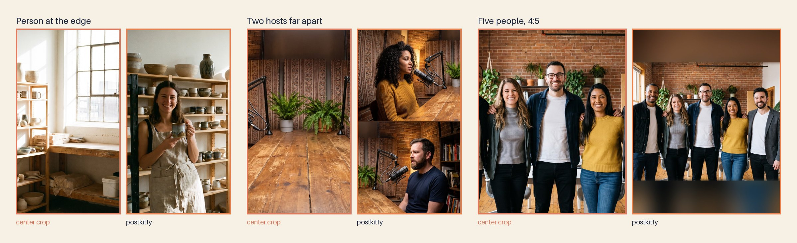
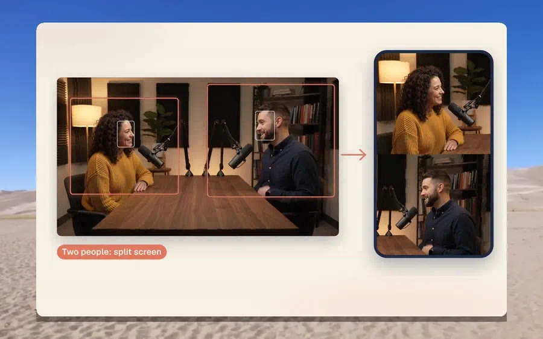

# Layouts and focus

A layout is how postkitty fits your photo or video into a target's shape. postkitty picks one for each target from the faces it finds. You can ask for another, in words ([How to ask](how-to-ask.md#pick-a-layout)) or with the `layout` and `focus` keys of [`postkitty_make` and `postkitty_redo`](tools.md#postkitty_make).

In each pair the center crop is on the left and the postkitty result is on the right. From left to right the results are a `crop`, a `split` and a `pad`.

## The five layouts

| Layout | What you get | Use it when | Works on |
|---|---|---|---|
| `crop` | One window around the subject. In a video the window follows the person as they move. | One person, or a group that fits the target's shape. | Photos, video |
| `split` | Two panels stacked in a vertical frame, one person in each. | Two people sit too far apart for one vertical window. | Photos, video |
| `speaker` | A full-height crop that cuts to the person who is talking. | A conversation where the listener can leave the frame. | Video |
| `seam` | The full scene with background removed from between the people, so they move closer. | Two people stand a little too far apart for a crop. | Photos |
| `pad` | The whole frame, centred on a blurred and darkened copy of itself. | Everyone has to stay in, and no crop can hold them. | Photos, video |

`auto` hands the choice back to postkitty.

## What postkitty picks

**Photos**

1. A crop, when one window holds every person.
2. A split, when the target is vertical and the photo shows exactly two people.
3. A pad in every other case, so nobody is cut.

A photo with no face is cropped around its most prominent subject.

**Video**

1. A split, when the target is vertical, two people share a shot, and one vertical window cannot hold both.
2. A crop that follows the person on screen in every other case.

`speaker`, `seam` and `pad` are yours to ask for. postkitty also falls back to `pad` by itself in one case: a rendered file fails the check that every person stays in frame, and the repair makes it again with the whole frame.

## When a layout cannot be made

| You asked for | The footage has | What happens |
|---|---|---|
| `split` on a video | No shot with two people | postkitty makes a crop and says so in the result. |
| `speaker` on a video | No shot with two people, or no face | postkitty makes a crop and says so in the result. |
| `split` on a photo | One person, three or more, or a square or landscape target | The call returns a message, and nothing is rendered. |
| `speaker` on a photo | | The call returns a message that names the layouts a photo can use. |
| `seam` on a video | | The call returns a message. |

## Focus

Focus says which person or which part of the frame a crop is built around.

| Value | Meaning |
|---|---|
| `auto` | The people postkitty found. This is the default. |
| `person:N` | One person. `person:1` is the leftmost, counted as people first appear. |
| `left`, `center`, `right` | The left edge, the middle or the right edge of the frame. |
| `x:0.0` to `x:1.0` | A point across the frame, from the left edge (`0.0`) to the right edge (`1.0`). |

`auto` cuts nobody, and `person:N` keeps that person whole: a file that would cut them fails its check and is made again as a `pad`. A side or a point is taken as given, in a photo and in a video. The crop is made where you asked, the file is ready, and an advisory says how many people are outside the frame. In a video that means outside for most of the clip.

A focus on one person turns a split into a crop of that person. Asking for `person:3` when two people were found returns a message with the number of people in the file.

## Trim and cover frame

These two belong to video targets.

| Key | Value | When you leave it out |
|---|---|---|
| `trim` | `[start, end]` in seconds. An end past the clip stops at the clip's end. | The whole clip when it fits the platform's maximum length. Where that maximum is a hard limit, a longer clip is cut to it, at the window with the most faces on screen and the most sound. A recommended length is reported and the clip is left whole. |
| `cover_at` | A time in seconds, inside the trim | The sharpest frame that shows a face and sits away from a scene cut. |

The cover is saved next to the video as `<name>_cover.jpg`.

## Captions

Captions from an `.srt` or `.vtt` file are drawn at the bottom of the frame, at most two lines at a time. They sit inside the platform's published safe area where the platform publishes one, and inside postkitty's own default margin otherwise. TikTok and YouTube Shorts publish separate left and right insets, Instagram and Facebook Reels publish one inset for both sides, and Threads and Bluesky get postkitty's default. [Platforms](platforms.md) shows the safe areas on the "Keep clear of the edges" rows, and [How to ask](how-to-ask.md#add-captions) says how to request captions.
